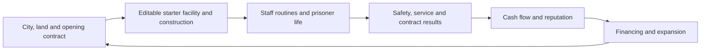
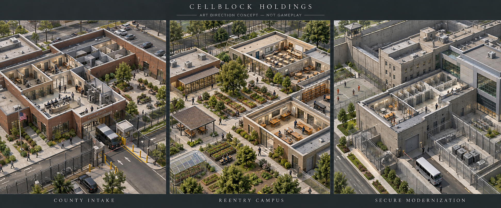

# Cellblock Holdings — reboot discussion draft

Status: evolving design brief. User decisions are recorded below; implementation recommendations and examples remain proposals.
This describes a new Unity game built around the owner's facility and company decisions.

## What the user has established

- Keep the repository name and overhaul the game.
- Use Unity for the reboot. Unity 6, C#, and URP are the implementation baseline; the installed Mac editor version still needs inspection in a local execution session.
- Build a highly customizable prison owner simulation: choose a city, acquire land, design a facility, manage people and amenities, hire and train workers, and pursue government contracts.
- Include a meaningful business journey, potentially including public ownership and outside investments. Teach economics through play.
- Give mobile and Steam equal consideration from day one, with mobile the main experience. Explicit Apple targets are iPhone, iPad, and Mac; the user already has an Apple Developer account and familiarity with Apple's ecosystem. Include Windows if it is practical and performs well; this is conditional rather than an unconditional launch commitment. The Mac distribution route is still open.
- Give facility building and company management equal design priority from the beginning.
- Begin with a budget and a choice among several contracts. The chosen offer shapes the opening opportunities and constraints. Provide a basic functional starter facility that the player can expand and redesign throughout.
- Support complete building freedom, including straight, diagonal, curved, and unusual layouts. Prefabricated rooms and structures can be placed, connected to existing construction, and edited afterward. The player can hire construction crews and add crews to accelerate work.
- Use the user's iPhone 17 Pro, iPad Pro, and M4 MacBook Air as the first available hardware references. The iPad generation and device memory are unspecified. These are initial validation devices, not a declared minimum supported hardware list.
- Pause the simulation when the app closes, with pause and fast-forward controls while playing. The user accepted this clock model and instructed implementation to begin. They report Unity installed on the current Mac, described as a Mac Pro; do not assume that is the earlier M4 Air.
- Aim for realistic, polished presentation: believable people, architecture, materials, and animation. The user rejects childish or stick-figure presentation. Narrative tone remains undecided; visual realism does not settle whether the writing is earnest or satirical.
- Use an independent critic, discuss tradeoffs, and ask questions as the idea develops.

Unity implementation has started at the repository root. The C# core has executable cloud checks, while Unity/editor/device execution is still required. No paid purchase or publication has occurred.

## Proposed promise

**Build the institution. Run the company. Live with the consequences.**

Begin by comparing several government contract opportunities, their city and site conditions, starting budgets, and associated basic facility models. Choose an offer, take control of a functional starter prison, and shape its layout and business around the commitments made. The model is an editable starting point. Its physical design and the lives inside it determine the company's financial position and opportunities.

Land acquisition remains part of the ownership fantasy. The opening transaction must show how the site and starter buildings are acquired or funded, which costs reduce the budget, and how much cash remains for operation. Later acquisitions can include vacant land, facilities, and redevelopment sites. The exact opening ownership arrangement remains a design decision.

The central relationship is:

The player should care about the prison even after unlocking a company dashboard. Corporate decisions need visible consequences in the facility, and facility improvements need consequences in the accounts.

## Direction and remaining technical choices

| Decision | Recommendation | Reason and tradeoff |
| --- | --- | --- |
| Engine | Unity 6 with C# and URP 17.0.4 is the current code baseline | The Mac launcher selects an installed Unity 6 editor and records its actual version. Engine APIs and package imports still require editor validation. Simulation performance must be profiled. |
| Platforms | iPhone and iPad as primary touch experiences; Mac and Steam participate in the first technical slice, with an early Windows feasibility check | Initial hardware references are iPhone 17 Pro, iPad Pro, and M4 MacBook Air. Include Windows if practical and validated; its launch status is conditional. Validate sustained performance, controls, memory, and input differences. The Mac storefront remains open. |
| Camera and art | Realistic 3D with believable scale, architectural materials, restrained animation, roof cutaways, and readable close views | This follows the user's visual direction. Fidelity needs a defined mobile rendering budget, strong art direction, and representative on-device scenes. Narrative tone remains open. |
| Player role | Facility owner and company leader from the first session | Include consequential contract, cash, staffing, and physical design decisions immediately. Multiple facilities and public ownership add complexity later; equal importance does not require all corporate mechanics in the tutorial. |
| Regional scope | Cities as distinct economic and contractual contexts | Wages, land, climate, transport, suppliers, regulation, and contract availability matter without requiring a second city simulation. |
| Information | Explain consequences and show uncertainty | Reports may be incomplete or delayed, but the player needs evidence, warning signs, and a way to understand outcomes. |

Business model, online requirements, exact camera/perspective, narrative tone, and the interaction between company and facility views remain undecided. A paid game with full saves and player-controlled time is the critic's provisional preference; this is not a monetization decision.

## Opening contracts: proposed examples

These are fictional design examples, not balanced offers or claims about actual government procurement. Each starts with basic operational capacity, an editable facility, understandable commitments, and a visible operating reserve. The opening must contain several genuinely selectable offers; it must not be reduced to one predetermined path.

| Offer | Starter model | Opening business choice | Builder emphasis | Main risk |
| --- | --- | --- | --- | --- |
| County custody and intake | Compact reception, short-stay housing, secure transfer and visiting areas | Compare a service retainer with additional per-day payments; budget for uneven arrivals and payment timing | Intake flow, flexible housing, transport/service separation, and scheduling | High turnover can overwhelm processing capacity even when beds are available |
| Rehabilitation and reentry | Small low-security campus with basic housing, education, healthcare access, and visiting space | Compare reliable operating support with a later, explicitly defined verified service-delivery bonus; fund programs before any bonus arrives | Classrooms, workshops, family access, staff coverage, and efficient shared services | Benefits are delayed and uncertain while wages and services cost money now |
| Secure facility modernization | Small existing higher-security prison with working but dated equipment and basic services | Choose an achievable upgrade schedule and retain cash for specialist staffing | Controlled circulation, sightlines, service routes, staged replacement, and separation of incompatible activities | Renovations can disrupt required services; stronger obligations also raise fixed costs |

The first contract establishes a starting situation, not a permanent character class. Later choices can change the company's focus, subject to current commitments and capability. Different terms must support different viable strategies without one offer being a disguised beginner trap. Opening higher-security custody needs a viable trained team or funded staffing arrangement; the player must not inherit unavoidable failure.

For the first playable, the offers must share the initial room, routine, staffing, service-capacity, and accounting systems. Establish their identities through layout, scheduling, payment terms, and commitments; stage deeper specialist systems separately. An opening reentry bonus can measure verified program delivery. Post-release outcomes need persistent follow-up over a credible longer timeline and cannot be treated as an immediate operating result.

Equal facility and company focus means the first session includes a contract decision, one real capital-allocation choice, a staffing commitment, and a physical redesign whose effects reach the ledger. Company decisions can be made in the facility view through contextual forecasts and approvals; a dashboard is useful when it answers a decision.

## Visual realism and narrative tone

The agreed visual direction is mature and realistic. Proposed art requirements include credible human proportions and movement, coherent materials, authentic scale, restrained colors, legible lighting, and consistent construction details. Avoid exaggerated idle gestures, mascot proportions, oversized heads, and decorative effects that obscure operations.

Realistic appearance can support different writing approaches. Consider the same event: an expansion causes a cash shortage before a contract payment arrives.

- Grounded management: the finance manager presents dates, reserves, consequences, and workable options; the player decides.
- Institutional drama: the same accounting problem is also explored through an employee conversation and its effect on trust and services.
- Dry corporate satire: formal language and investor priorities expose a contradiction between the reassuring report and what is happening in the facility. The people and animation can still look believable.

These are illustrative writing treatments, not a forced choice or additional confirmed game modes. The user wants examples before deciding tone. A visual concept study is an art discussion aid, not evidence of an implemented scene or achieved device performance.

This generated visual study explores three facility identities within one mature, realistic art direction. Use it to discuss architecture, materials, scale, cutaways, and atmosphere. It is not a gameplay capture, approved final asset specification, or measured mobile rendering target.

## What makes this game distinctive

### A facility whose economics are visible

Physical routes matter: kitchens, intake, visiting rooms, medical care, staff facilities, deliveries, and secure movement compete for space and time. A cheaper building can create a more expensive operation. When a metric worsens, the player can inspect a contributing chain of events rather than guess which invisible meter to satisfy.

Example: expanding beds without expanding meal service creates queues. Officers spend longer escorting people, overtime increases, and the next shift starts short. The player can redesign circulation, stagger schedules, increase kitchen capacity, or reduce the contractual commitment. Each has a different cost and effect.

### People whose histories persist

Prisoners have needs, relationships, health, capabilities, and individual circumstances; staff have skills, fatigue, pay expectations, and career development. A recurring person is more memorable than a population counter. Show a manageable selection of meaningful stories rather than promise bespoke writing for every simulated individual.

Policies and layouts influence these lives. Financial success should coexist with obligations around safety, living conditions, lawful operation, and rehabilitation. Different operating models should have genuine tradeoffs; neither cruelty nor a single expensive upgrade should be a universal winning strategy.

### Contracts that create different prisons

Contracts specify who the facility serves, capacity commitments, security and service requirements, payment timing, measurable outcomes, penalties, and renewal terms. A rehabilitation-focused contract and a high-security contract should call for meaningfully different staffing and architecture.

Terms must be understandable before signing. Forecasts expose assumptions and uncertainty. Contract negotiation initially uses a few consequential choices rather than an unrestricted legal-document editor.

### Ownership that changes as the company grows

Land, working capital, debt, and reinvestment come first. Additional sites introduce delegation and portfolio risk. An IPO later trades ownership and control for expansion capital; shareholder expectations, dilution, disclosure, and dividends create decisions rather than a decorative stock-price chart.

Outside investments are a later candidate. Their value must relate to the business or create an understandable allocation tradeoff. A broad securities market could overwhelm the builder and needs a separate case for inclusion.

### A quality bar that can be checked

The user's request for maximum effort means coherent art and dependable interaction as well as system depth. Establish a representative visual benchmark with convincing building scale, consistent material quality, believable walking and work animations, attractive lighting, and readable people and props at practical phone zoom levels. Clipping characters, flickering cutaways, repeated animation glitches, illegible financial screens, imprecise placement, and lost saves are quality failures even when an overview image looks impressive.

Review the benchmark on actual target devices under a sustained operating workload. Concept art defines a direction; a rendered desktop scene, editor capture, or device simulator does not establish iPhone quality or performance. Define named hardware and numeric budgets after measuring the first representative scene.

### Surprises with traceable causes

An impressive moment can be the facility coming alive: morning routines, coordinated deliveries, a first successful inspection, a trained employee taking charge, or a redesigned corridor fixing a recurring failure. Incidents also emerge from conditions, incomplete information, and choices. Constant random disasters would punish improvement and erase the satisfaction of competent management.

## Proposed progression

| Stage | Player responsibility | New decision |
| --- | --- | --- |
| First site | Compare contracts, acquire the starting package, manage a basic facility, allocate reserves, and redesign it | Which opportunity suits my preferred operation, and how do I improve it without breaking its commitments? |
| Stable operation | Schedules, amenities, training, maintenance, procurement | Which bottleneck deserves the next investment? |
| Specialist facility | More demanding contracts and facility identities | Which services can this location and workforce deliver well? |
| Regional company | Additional sites and accountable local managers | What should I standardize, delegate, acquire, or finance? |
| Public company, if retained | Capital structure, reporting, shareholders | How much ownership and flexibility am I willing to trade for growth? |

These are proposed layers of the finished experience, not a promise to implement all of them in the first build.

## Economics taught through decisions

| Concept | Playable situation | Evidence available to the player |
| --- | --- | --- |
| Profit versus cash | Contract revenue is earned before payment arrives; payroll still falls due | Cash forecast, receivables, payment schedule, and operating result |
| Fixed and variable costs | A new wing adds capacity but requires a minimum staffed shift | Capacity, workload, wages, and marginal contribution |
| Opportunity cost | Spend reserves on training, a kitchen expansion, or debt reduction | Estimated effects, alternatives, and forecast assumptions |
| Debt and risk | Borrow to meet a new contract deadline | Debt service, reserves, downside scenarios, and covenants |
| Ownership and dilution | Issue shares to fund expansion | Ownership before and after, funds raised, and new obligations |
| External consequences | A short-term saving affects workers, people in custody, and the surrounding community | Operational reports, individual outcomes, oversight, and contract renewal |

Forecasts are tools for informed judgment, not guarantees. Simplified game mechanics must not present themselves as universal rules about real economies or justice systems.

## First playable: prove one connected loop

Target several selectable opening offers, their small editable starter models, one shared construction kit, small prisoner cohorts, a few essential staff roles, contract and working-capital decisions, one operating cycle, and save/load. Scope the initial offers to reuse systems and assets while creating meaningfully different terms and layouts. Population counts and map limits are profiling targets to establish, not performance promises.

The first session should let the player:

1. Compare opening offers, associated cities/sites, starter models, budgets, and commitments.
2. Choose a contract and see the acquisition cost, available cash, payment calendar, and operating reserve.
3. Inspect the functional starter facility, its team and services, then plan a meaningful modification with visible construction and operating effects.
4. Manage intake and watch the institution operate while making a staffing or capital-allocation decision.
5. Discover or prevent a manageable operational weakness caused by their design or schedule.
6. Choose an improvement and see its effect on service, people, and cash.

An engineering spike may temporarily isolate one facility, but the first playable design must demonstrate the requested opening contract choice and both management layers. Additional contract breadth, landscaping depth, multistory complexity, detailed training trees, a regional portfolio, and capital markets expand after that foundation works. Use opening scenarios with several valid solutions; an attentive player should be able to prevent a problem rather than endure a forced disaster.

The vertical slice passes when a new player can explain an operational problem, change its physical or management cause, observe a plausible result, and understand the associated financial tradeoff. Two plausible layouts with the same intake, roster, and contract must produce meaningfully different operating results. Opening cash, recorded transactions, and closing cash must reconcile.

It also needs a usable camera, dependable building feedback and undo/planning behavior, save/load, and measured sustained frame and simulation timing on named iPhone, iPad, and Mac reference devices, plus any agreed Windows/Steam target. Validate phone construction and financial readability as well as suspend/resume behavior in this first slice. An initial proposed usability bar is four of five first-time players explaining one construction-to-operation-to-finance chain without coaching; this is a future validation target, not a test already performed. Testers should want to improve or replay the facility; a functioning ledger alone does not establish that the game is fun.

### Candidate first 30 minutes

| Time | Experience |
| --- | --- |
| 0–5 minutes | Compare several contract packages and their sites, starter facilities, obligations, budgets, and payment dates. |
| 5–10 minutes | Take control of the chosen basic facility and inspect the opening cash forecast and service capacity. |
| 10–18 minutes | Redesign part of the facility, allocate renovation funds, and adjust staffing or schedules. |
| 18–25 minutes | Observe routines and service capacity; compare actual operating results with the contract and cash forecast. |
| 25–30 minutes | Prevent or diagnose a bottleneck, improve the plan, and inspect the operational and financial result. |

This is a pacing hypothesis to test. Creative players can pause and take longer.

A second example of a memorable economic consequence: a new contract is profitable on paper, but construction invoices and weekly payroll fall due before the monthly government payment. The player can see those dates and choose an advance, phased intake, delayed construction, or financing. The learning comes from managing working capital, not an unannounced bankruptcy event.

## Builder direction: full ownership of the design

The user wants every aspect of the starter facility to be redesignable. There should be no permanently locked tutorial rooms, compulsory starter furniture, or uneditable foundational layout. Ordinary spatial, budget, safety, and contractual constraints still make choices consequential; the tools should explain a conflict and allow a renovation plan to solve it.

The customizable domains are the site and layout; walls and rooms; corridor widths; doors and access; utilities; fixtures and furnishings; materials, color and exterior appearance; landscaping; schedules and service policies; staffing; and reusable blueprints. Straight, diagonal, curved, and unusual layouts are confirmed requirements. The number of floors, terrain-tool depth, and exact geometry controls remain open. The builder must support editable geometry as well as modular content.

Planning should quote cost and show feasibility before money is committed. Paused planning can allow cancellation and revision before work begins. Live renovations can relocate occupants, create temporary capacity, reroute services, and phase demolition and construction; completed work has real costs and is not universally reversible without consequence. The player should be able to replace any starting area through a feasible plan.

High customization should include functional choices and visual expression. A long object catalogue without different uses will not create depth. Freeform construction is now required and needs an early engineering proof. Multistory construction, terrain manipulation, and walk-through presentation still need separate scope decisions because they affect pathfinding, controls, visibility, and content production.

### Editable prefabs and connected structures

Prefabs should be reusable blueprints that instantiate editable walls, spaces, openings, fixtures, and service connections. After placement, each part can be changed with the same tools as hand-built geometry. Editing one placed wing should not silently modify every other copy. Explicitly saving a new blueprint can preserve the player's variation.

Placement should preview alignment with existing walls, floor levels, doors, circulation, and utilities. Offer snapping and connection suggestions with an optional free placement mode. Shared walls and overlapping elements need an explicit, predictable resolution in the preview; avoid double-charging for a shared element or silently removing a secure boundary.

Curved and diagonal geometry must still form valid spaces, support compatible openings, and produce usable routes. Validate narrow passages, blocked door swings/access, self-intersecting boundaries, overlapping occupied space, and out-of-bounds construction with specific feedback. Physical and contractual constraints are part of planning. The tools should show how to resolve them instead of accepting an unusable plan without explanation.

If a chosen door requires a flat mounting face, offer a previewed short flat opening within the curve while preserving the player's overall design. Room detection must handle closed boundaries and courtyards consistently. Floors, roofs, collision, and navigation should use the approved geometry, and utilities need persistent connections and capacity. A wall edit must not silently duplicate a boundary, disconnect a service, or create a traversable opening that the visible building does not contain.

### Construction crews and live renovations

The owner hires crews, assigns projects and priorities, and can add crews to finish work sooner. Construction is a visible operating system with labor, materials, equipment where relevant, and site access. Different teams may offer different costs, availability, and skills; the exact hiring model remains a proposal.

Additional crews increase productive capacity when tasks can run in parallel. A single constrained doorway, a missing material delivery, or a dependent task cannot absorb unlimited labor. Show estimates and the actual limiting factor before the player pays for more crews. Give useful alternatives such as splitting work fronts, rerouting access, rescheduling deliveries, or assigning a crew to another project.

Projects can include preparation, safely isolated demolition, structure, enclosure, service connections, furnishings, inspection, and handover as appropriate. Only completed operational elements affect the prison's usable spaces and services. Planning previews must not block real routes or count unfinished cells as available capacity.

Renovations must preserve a coherent construction state. Provide temporary routes and relocation plans, show required service continuity, and let the player stage closures. Confirm the first proof can rebuild part of an operating facility rather than only extend into empty land. Explain labor, materials, advance payments, recurring crew costs, cancellation terms, and the difference between committed spending and cash already paid without charging the same work twice.

Example: attach a prefab wing to the existing prison, rotate and reshape its entrance, add a curved communal space, and connect the service routes. One crew can work on the new shell while another prepares a safe connection corridor. Both may accelerate the overall project, but final connection waits until relocation and access requirements are satisfied. The owner can choose a phased opening or pay for extra temporary capacity.

### Earliest construction proof

Before expanding content production, demonstrate one compact site on an actual iPhone with these capabilities:

1. Attach an editable prefab to existing construction, then alter its rooms and connection geometry.
2. Draw and edit straight, diagonal, and curved walls while preserving coherent rooms, doors, roof cutaways, and routes.
3. Quote and stage a live renovation with temporary access and services.
4. Compare one crew with two crews on parallel work, then show a dependent or access-limited task with an understandable estimate.
5. Show completed construction changing daily operation, cash, and contract capacity.
6. Save, reload, and suspend/resume both the plan and partly completed construction without duplicating charges or losing task state.

This is a proposed engineering and interaction proof, not an implemented or validated feature list. It precedes the broader first playable with multiple opening contract choices. Test equivalent edits with touch on iPad and keyboard/mouse on Mac; check the Windows path early enough to inform the platform decision.

Proposed first-user check: four of five new users can place, join, reshape, and reconnect the extension with fingers without coaching. Deliberately test an invalid doorway and a renovation stage that would cut off the only usable route; both need an actionable explanation. A valid staged plan preserves occupant routes until handover, and the same work cannot be charged twice after reload. These are future acceptance criteria, not completed tests.

## Touch, iPad, and Mac interaction direction

- Begin with a landscape iPhone prototype; validate orientation and ergonomics rather than assuming a desktop layout will fit.
- Give navigation and construction explicit modes so camera movement does not accidentally place or demolish objects.
- Prototype snapping, a placement ghost, visible dimensions, magnified or offset placement under a finger, and confirmation before costly changes. Preserve precise controls for experienced players.
- Keep phone management screens focused on the current decision, with access to detailed forecasts and records. iPad and Mac can expose additional simultaneous panels using the same underlying systems.
- Support touch on iPhone/iPad and keyboard/mouse on Mac; investigate optional Pencil and trackpad behavior on iPad after the base controls work.
- Use continuous zoom, automatic roof cutaways, room isolation, and optional overlays to show realistic spaces without hiding people or paths.
- Define one shared game with platform-specific input and presentation. Hardware limitations and scenario scale need measurement; equal platform priority does not imply identical rendering settings or unlimited population.

## Hardware and performance decisions

| Device or platform | Current role | What remains to establish |
| --- | --- | --- |
| iPhone 17 Pro | First phone reference for freeform construction, scene fidelity, simulation, and lifecycle checks | Actual device connection; sustained rendering/simulation budgets; memory use; minimum supported iPhone |
| iPad Pro | Tablet interaction and larger-screen reference | Generation/chip; actual device connection; touch and optional accessory validation |
| M4 MacBook Air | Development-machine candidate and initial Mac play target | Available memory/storage; Unity/Xcode installation and accessible execution path; sustained native build behavior |
| Windows / Steam | Candidate target retained if practical and smooth | Test hardware; Windows packaging and input validation; maintenance/release commitment after evidence |

The user's devices give us specific reference hardware, but ownership does not establish that this session can access them or that builds perform well. Smoothness must include consistent frame pacing, responsive edit previews, limited construction/navigation rebuild stalls, reliable input, and stable performance over a sustained session. Population limits, the minimum supported device list, and numerical budgets remain to be measured and set deliberately.

## Simulation time: confirmed

The user accepted player-controlled time: pause, normal speed, and faster speeds while playing, with the world saved and paused when the app closes. The current code implements that model, without elapsed real-time catch-up. It supports deliberate building, makes mobile interruptions manageable, and keeps construction durations inside the game clock. Resumed company saves open paused.

Construction and operations use the same game clock. Absence does not advance payroll, deliveries, construction, incidents, or contract income. Native application pause/focus and platform save behavior still need real-device validation; code inspection and standalone core checks do not prove iOS lifecycle behavior.

## Implementation foundations and work to validate

- Keep business and agent simulation in a testable C# domain layer if Unity is selected. Rendering and input consume simulation state and issue validated commands.
- Use a fixed simulation clock, seeded randomness where useful, explicit data formats, and versioned saves. Aim for reproducible behavior without promising cross-platform deterministic lockstep.
- Model construction, room access, circulation, work allocation, service capacity, and accounting as connected systems. Profile navigation and decision frequency before adding more people or sites.
- Investigate authoritative editable wall/curve and opening data, with generated room topology, meshes, cutaways, and navigation derived from it. Keep stable identities for persistent spaces and work orders. Restrict geometry regeneration and navigation changes to affected regions where feasible. The exact geometry/navigation implementation needs the construction proof; rendering smooth curves alone does not prove valid circulation.
- Let future content definitions describe rooms, objects, roles, services, and contracts without hardcoding every scenario.
- Share simulation rules across desktop and mobile, while allowing different presentation, controls, and validated scenario limits.
- Do not assume every unobserved facility can run at full agent detail. Compare detailed and aggregate approaches experimentally; switching sites must preserve people, commitments, inventories, and finances rather than reroll the outcome. The acceptable loss of detail remains an open design decision.
- Treat mobile suspend/resume, local saving, battery, thermals, screen readability, and touch building as first-slice acceptance concerns. Offline progression is a design choice, not an automatic feature.
- Establish a realistic URP art benchmark on the named devices: representative materials, lighting, agent animation, cutaways, and UI. Evaluate baked lighting, instancing, level of detail, and render scale as appropriate. Do not promise a population cap or frame rate before sustained device profiling.
- Plan native macOS and Steam packaging if Steam on Mac is retained. Running an iPad app on compatible Macs is a different distribution and interaction choice and does not by itself produce a Steam build.
- Apple signing and device deployment require an appropriate macOS/Xcode development path. The existing Apple Developer account addresses account availability, not editor connectivity or device validation. Use secure signing flows; do not request credential values in chat.

## Critic's standing challenges

1. Does the physical facility determine business outcomes, or are the company screens disconnected minigames?
2. Can a player diagnose and influence failures, or are incidents surprising only because the rules are hidden?
3. Is there an enjoyable small prison before we add multiple sites and securities trading?
4. Do personal stories emerge from the simulation, or are they expensive writing disconnected from play?
5. Does mobile preserve the core decisions with usable controls and measured performance?

## Open questions for the next discussion

Resolved direction: mobile and Steam considered together from day one, mainly mobile; explicit iPhone/iPad/Mac intent; conditional interest in Windows; facility building and company management equally important; contract-led opening with a budget and fully editable basic facility; freeform construction and editable connected prefabs; hired construction crews with additional crews accelerating work; realistic, mature visual presentation; initial reference devices iPhone 17 Pro, iPad Pro, and M4 MacBook Air.

Immediate execution prerequisite: access the Unity installation on the current Mac in a local development session, compile/import the project, and run the construction proof. Inspect the actual editor version, Xcode availability, and device connections there. The iPad generation and exact reference-device resources can be checked while connecting the build path. Further design questions include company/world persistence and online requirements, financial failure/recovery, and the definition of a successful owner when profit conflicts with safety or staff welfare. Narrative tone remains deliberately open. Later discussion: scale; session length; fictional versus real places; campaign and sandbox; business model; asset budget; and optional multistory, terrain, or walk-through depth.

## Current tooling evidence

This chat currently operates in a Linux cloud workspace. No Unity editor/control integration or executable is available in that execution context. App metadata identifies a local project at `/Users/trading/Documents/ChatGPT/Cellblock Holdings`, but the tools cannot execute commands on that Mac or automatically synchronize the cloud checkout into it. The user authorizes local development and reports Unity installed. A local execution connection is still required for editor and device validation.

This brief describes the broader design. The first implementation source and its exact validation boundaries are recorded in [implementation status](implementation-status.md) and the root README. The standalone core checks pass; Unity compilation, rendering, Play mode, and device performance remain unverified.
